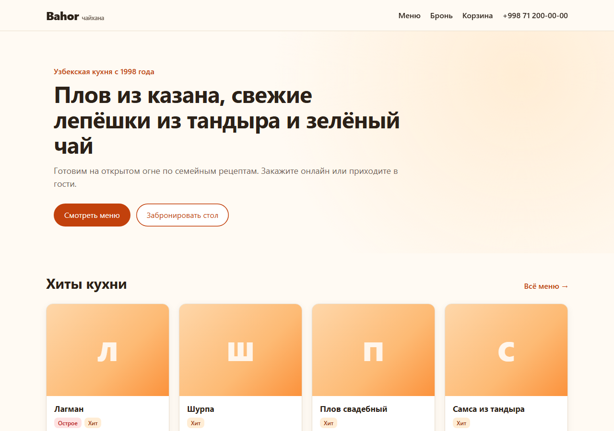
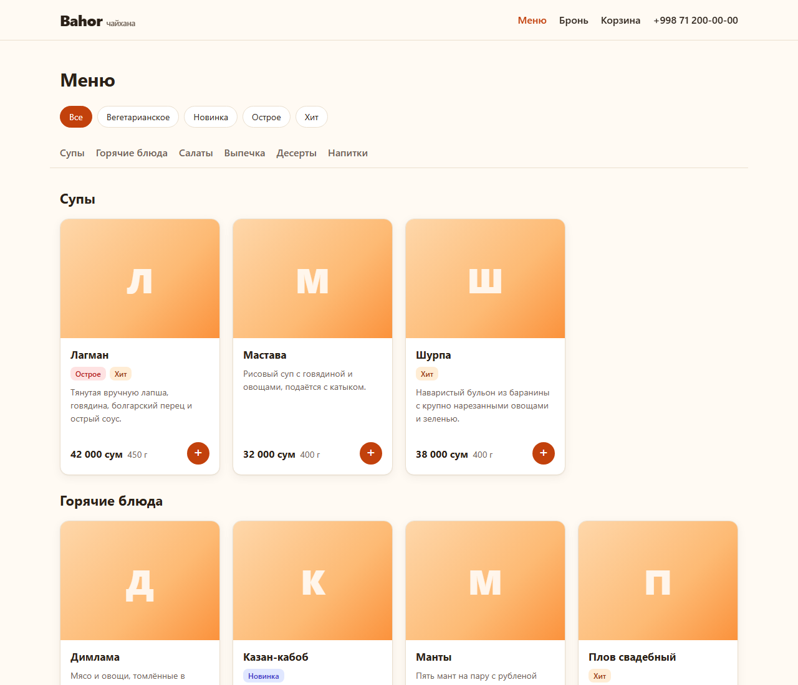

# Restaurant System

[Русская версия](README.md)

A restaurant management system built with Django: a guest-facing website, a REST API,
a real-time kitchen display and an analytics dashboard for the owner. The demo venue is
"Bahor", an Uzbek teahouse (UI texts are in Russian).

**Stack:** Python 3.12 · Django 5.2 · Django REST Framework · PostgreSQL 16 ·
Celery + Redis · Django Channels (WebSocket) · Docker · Caddy · pytest · GitHub Actions

<p>
  
  
</p>

## Features

- **Menu** with categories, tags and a stop-list the cooks control.
- **Table reservations**: live availability, automatic table assignment
  (smallest table that fits), double booking prevented by `select_for_update`
  *and* a PostgreSQL `EXCLUDE USING gist` constraint on overlapping time ranges.
- **Orders**: session cart, delivery / pickup / dine-in via a QR code on the table,
  prices always taken from the database and snapshotted into order items.
- **Order state machine** with per-role transitions and full status history.
- **Payments** behind a `PaymentProvider` interface: Stripe Checkout and a fake
  provider for local development. Webhooks are signature-checked, idempotent and
  amount-verified.
- **Real time**: kitchen display and guest order page update over WebSocket;
  events are broadcast after the transaction commits.
- **Background jobs** (Celery Beat): auto-cancel unpaid online orders after 15 minutes,
  email reminders 2 hours before a reservation, Telegram notifications to the manager.
- **Analytics**: revenue by day, top dishes ranked with `ROW_NUMBER()`, hourly load,
  KPIs compared with the previous period, all computed with database aggregates
  in the restaurant's time zone.

## Quick start

```bash
cp .env.example .env
docker compose up --build
docker compose exec web python manage.py createsuperuser
docker compose exec web python manage.py seed_data --with-staff --with-orders 300
```

Open http://localhost:8000/ (site), `/api/docs/` (Swagger), `/staff/kitchen/` and
`/staff/analytics/` (staff, demo users `demo_manager`, `demo_cook`, …).

## Quality

- 380+ tests, ~98% coverage, query counts pinned with `django_assert_num_queries`.
- CI: ruff, tests on PostgreSQL, migration and `check --deploy` checks,
  production image build with a container health check.
- Business logic lives in `services.py` / `selectors.py`; views stay thin.

## Deployment

Single VPS with `docker-compose.prod.yml`: Caddy (automatic HTTPS) → Daphne (ASGI),
Celery worker and beat, PostgreSQL, Redis. Step-by-step guide (in Russian):
[docs/deploy.md](docs/deploy.md).

Production hardening covered by tests: real client IP behind the proxy
(`NUM_PROXIES`), shared Redis cache for rate limits, staff login lockout,
a health check that bypasses the SSL redirect and host validation, and a
refusal to start with the fake payment provider.
