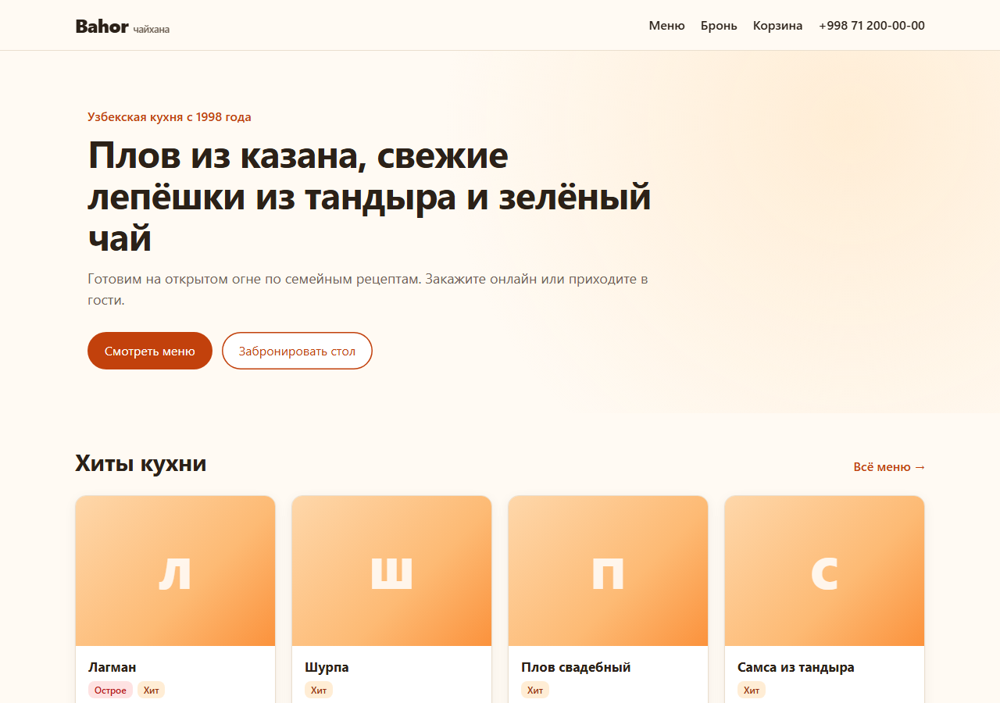
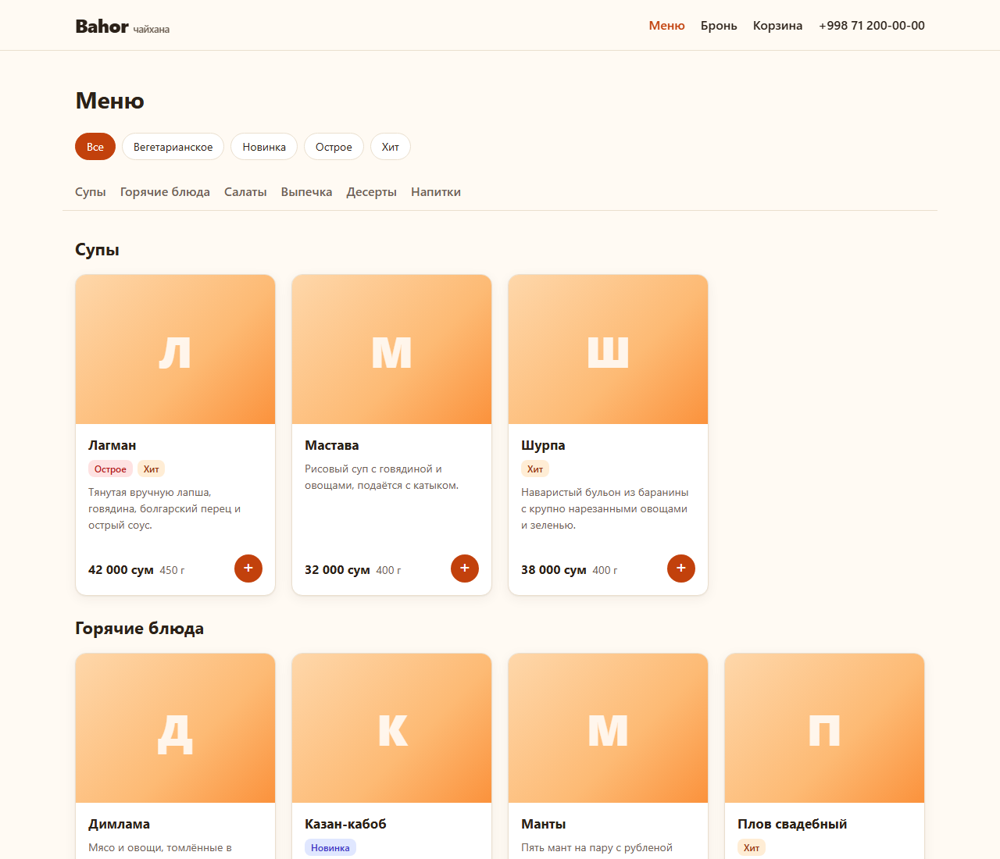
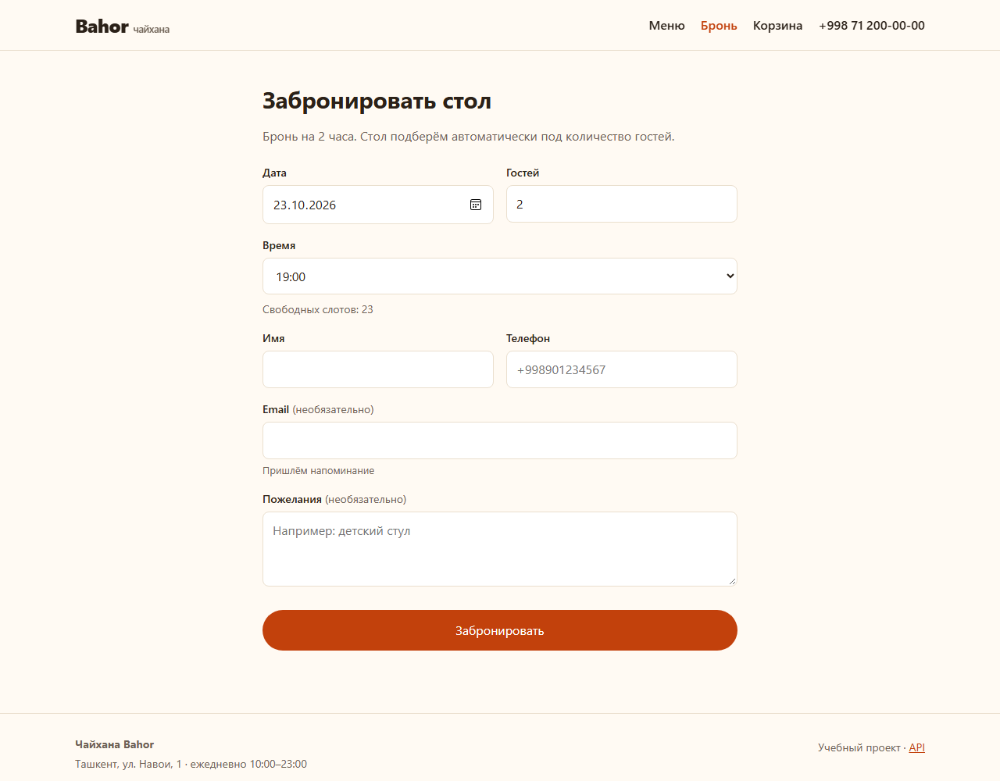
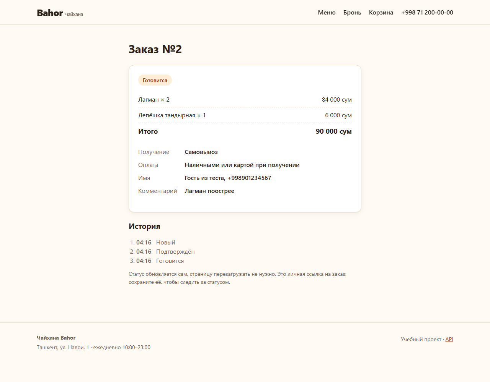
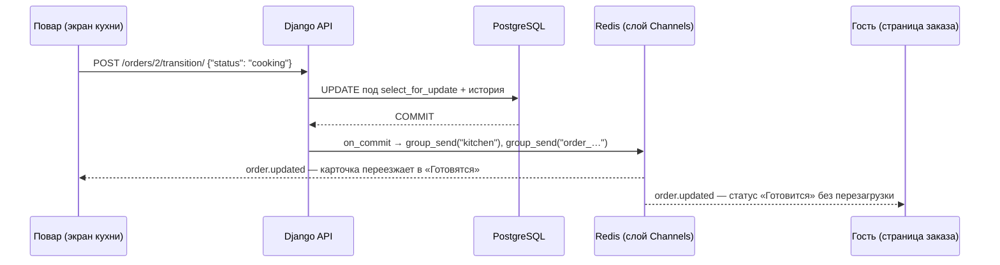
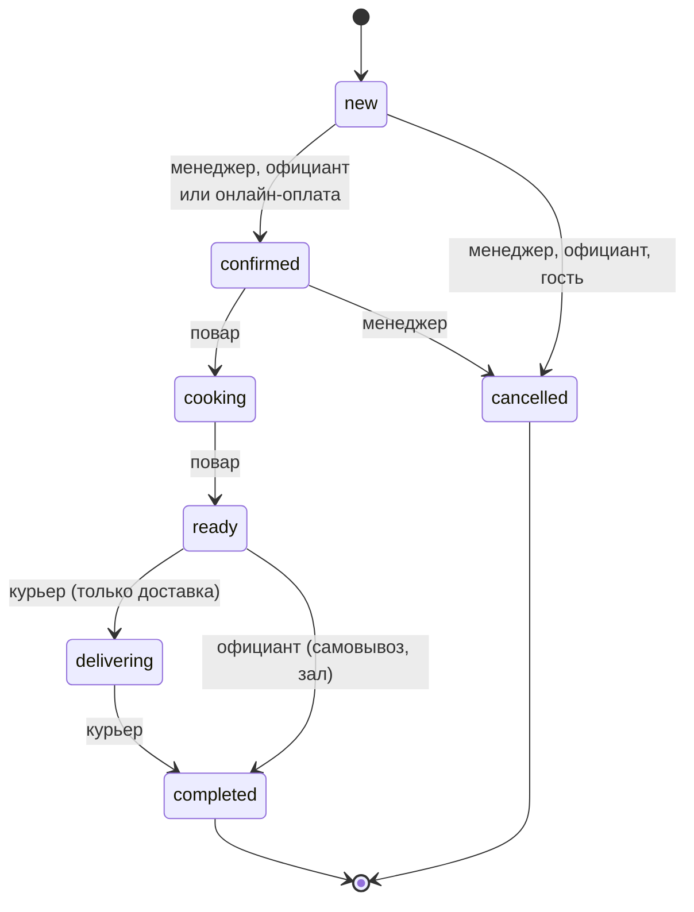
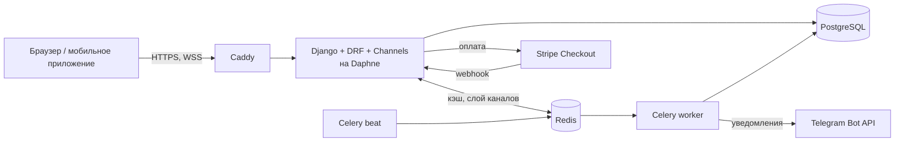

# Restaurant System

[English version](README.en.md)

Система управления рестораном на Django: сайт для гостей, REST API, экран
кухни в реальном времени и аналитика для владельца. Демо-заведение —
узбекская чайхана «Bahor».

**Стек:** Python 3.12 · Django 5.2 · Django REST Framework · PostgreSQL 16 ·
Celery + Redis · Django Channels (WebSocket) · Docker · Caddy · pytest · GitHub Actions

<p>
  
  
</p>
<p>
  
  
</p>

## Возможности

**Для гостей**
- Меню с категориями, тегами (острое, вегетарианское, хит) и стоп-листом.
- Бронирование столика: свободное время подгружается при выборе даты,
  стол подбирается автоматически, двойная бронь исключена на уровне БД.
- Корзина и заказ на доставку, самовывоз или к столу по QR-коду.
- Онлайн-оплата через Stripe и страница заказа, статус на которой обновляется сам.
- Личные ссылки на бронь и заказ: всё работает без регистрации.

**Для персонала**
- Роли: администратор, менеджер, официант, повар, курьер.
- Экран кухни: новые заказы появляются без перезагрузки, у каждой роли свои кнопки.
- Статусы заказа по правилам state machine с историей изменений.
- Уведомления менеджеру в Telegram о заказах и бронях.
- Дашборд: выручка по дням, топ блюд, загрузка по часам, сравнение с прошлым периодом.

**Под капотом**
- 380+ тестов, покрытие ~98%, CI на PostgreSQL с проверкой Docker-образа.
- Фоновые задачи: автоотмена неоплаченных заказов, напоминания о брони.
- Продакшен на одном сервере: `docker compose` + Caddy с автоматическим HTTPS
  ([инструкция по деплою](docs/deploy.md)).

## Быстрый старт

Нужен [Docker Desktop](https://www.docker.com/products/docker-desktop/).

```bash
cp .env.example .env
docker compose up --build
```

Если порт 8000 занят (на Windows его иногда резервирует система), выбери другой:
`WEB_PORT=8765 docker compose up --build`.

Создать администратора и заполнить базу демо-данными (меню узбекской кухни,
10 столов, сотрудники `demo_manager`, `demo_cook`, `demo_waiter`, `demo_courier`
с паролем из `SEED_STAFF_PASSWORD` или `DEFAULT_STAFF_PASSWORD` в
[seed_data.py](apps/menu/management/commands/seed_data.py)):

```bash
docker compose exec web python manage.py createsuperuser
docker compose exec web python manage.py seed_data --with-staff --with-orders 300
```

`--with-orders 300` создаёт историю заказов за 60 дней, чтобы дашборд аналитики
не был пустым. При повторном запуске демо-заказы пересоздаются.

| Адрес | Что там |
|---|---|
| http://localhost:8000/ | Сайт ресторана |
| http://localhost:8000/menu/ | Меню с фильтром по тегам |
| http://localhost:8000/reservations/new/ | Бронирование столика |
| http://localhost:8000/cart/ | Корзина и оформление заказа |
| http://localhost:8000/staff/kitchen/ | Экран кухни (вход: `demo_cook`, `demo_manager` и др.) |
| http://localhost:8000/staff/analytics/ | Дашборд выручки (вход: `demo_manager`) |

### Фоновые задачи и уведомления

| Задача | Когда | Что делает |
|---|---|---|
| `notify_new_order` | после коммита заказа (наличные) или после оплаты (онлайн) | Telegram менеджеру |
| `notify_new_reservation` | после коммита брони | Telegram менеджеру |
| `cancel_unpaid_orders` | каждую минуту (Celery Beat) | Отменяет онлайн-заказы, не оплаченные за 15 минут |
| `send_reservation_reminders` | каждые 5 минут (Celery Beat) | Письмо гостю за 2 часа до брони |

Чтобы получать уведомления в Telegram, создай бота через
[@BotFather](https://t.me/BotFather) и пропиши в `.env` `TELEGRAM_BOT_TOKEN`
и `TELEGRAM_CHAT_ID`. Без них сообщения просто пишутся в лог.

### Онлайн-оплата

По умолчанию `PAYMENT_PROVIDER=fake`: вместо платёжной системы открывается
тестовая страница с кнопками «Оплатить» и «Отменить». Она отправляет такой же
подписанный webhook, как настоящий провайдер, поэтому весь путь оплаты
работает без ключей. В продакшене `fake` запрещён настройками.

Чтобы проверить настоящий Stripe в тестовом режиме:

1. Возьми ключи в [Stripe Dashboard](https://dashboard.stripe.com/test/apikeys)
   и пропиши в `.env`: `PAYMENT_PROVIDER=stripe`, `STRIPE_SECRET_KEY=sk_test_...`.
2. Перенаправь webhook на локальный сервер через [Stripe CLI](https://docs.stripe.com/stripe-cli):
   `stripe listen --forward-to localhost:8000/api/v1/payments/webhook/stripe/`.
   Команда выведет `whsec_...`, его нужно записать в `STRIPE_WEBHOOK_SECRET`.
3. Оплати заказ тестовой картой `4242 4242 4242 4242`.
| http://localhost:8000/api/docs/ | Swagger, документация API |
| http://localhost:8000/admin/ | Django Admin |
| http://localhost:8000/health/ | Проверка живости сервиса |

## Тесты и линтер

```bash
docker compose exec web pytest --cov
docker compose exec web ruff check .
```

Без Docker тоже можно: тесты идут на SQLite, а 3 теста, которым нужен PostgreSQL
(параллельные брони и EXCLUDE-constraint), пропускаются. В CI они выполняются.

```bash
python -m venv .venv && .venv/bin/pip install -r requirements/dev.txt
DATABASE_URL=sqlite:///db.sqlite3 .venv/bin/pytest
```

CI ([ci.yml](.github/workflows/ci.yml)) на каждый push и pull request:
1. **lint:** ruff check и ruff format.
2. **test:** тесты на PostgreSQL 16 с покрытием от 70%, проверка миграций и `check --deploy`.
3. **docker:** сборка продакшен-образа, проверка `docker-compose.prod.yml`, запуск
   контейнера и ответ `/health/`.

## Деплой

Продакшен на одном VPS: `docker compose -f docker-compose.prod.yml up -d --build`
поднимает Caddy (HTTPS), Daphne, Celery, PostgreSQL и Redis. Пошаговая инструкция,
резервные копии и обновление описаны в [docs/deploy.md](docs/deploy.md).

## API

Все эндпоинты версионированы: `/api/v1/...`

| Метод | URL | Доступ | Описание |
|---|---|---|---|
| POST | `/api/v1/auth/register/` | все | Регистрация гостя |
| POST | `/api/v1/auth/token/` | все | Получить access и refresh токены |
| POST | `/api/v1/auth/token/refresh/` | все | Обновить access-токен |
| GET, PATCH | `/api/v1/auth/me/` | авторизованные | Профиль текущего пользователя |
| GET | `/api/v1/menu/dishes/` | все | Блюда: `?category=`, `?tag=`, `?price_min=`, `?price_max=`, `?search=`, `?ordering=price` |
| POST, PATCH, DELETE | `/api/v1/menu/dishes/{slug}/` | менеджер | Управление блюдами |
| PATCH | `/api/v1/menu/dishes/{slug}/availability/` | повар, менеджер | Стоп-лист |
| GET / POST, PATCH, DELETE | `/api/v1/menu/categories/`, `/api/v1/menu/tags/` | все / менеджер | Категории и теги |
| GET | `/api/v1/tables/` | менеджер, официант | Список столов |
| POST, PATCH, DELETE | `/api/v1/tables/{id}/` | менеджер | Управление столами |
| GET | `/api/v1/tables/{id}/qr/` | менеджер | PNG с QR-кодом для печати |
| POST | `/api/v1/tables/{id}/regenerate-qr/` | менеджер | Перевыпустить QR (старый перестанет работать) |
| GET | `/api/v1/tables/by-qr/{token}/` | все | Стол по токену из QR |
| GET | `/api/v1/reservations/availability/?date=&guests=` | все | Свободное время на день |
| POST | `/api/v1/reservations/` | все | Забронировать (стол подбирается автоматически) |
| GET | `/api/v1/reservations/my/` | авторизованные | Мои брони |
| GET | `/api/v1/reservations/` | менеджер, официант | Все брони: `?date=`, `?status=`, `?table=` |
| GET | `/api/v1/reservations/{id}/` | владелец, персонал | Бронь |
| POST | `/api/v1/reservations/{id}/cancel/` | владелец, персонал | Отменить бронь |
| POST | `/api/v1/reservations/{id}/status/` | менеджер, официант | Гость пришёл / не пришёл |
| GET, POST | `/api/v1/reservations/by-token/{token}/` (`cancel/`) | все | Бронь по личной ссылке гостя |
| POST | `/api/v1/orders/` | все | Создать заказ: позиции в теле запроса, цены берутся из БД |
| GET | `/api/v1/orders/my/` | авторизованные | Мои заказы |
| GET | `/api/v1/orders/` | персонал | Все заказы: `?status=`, `?type=`, `?date=` |
| POST | `/api/v1/orders/{id}/transition/` | персонал по ролям | Сменить статус по правилам state machine |
| POST | `/api/v1/orders/{id}/cancel/` | владелец | Отменить, пока заказ не принят |
| GET, POST | `/api/v1/orders/by-token/{token}/` (`cancel/`) | все | Заказ по личной ссылке |
| POST | `/api/v1/payments/checkout/{token}/` | все | Начать онлайн-оплату, в ответе `redirect_url` |
| POST | `/api/v1/payments/webhook/{provider}/` | платёжная система | Уведомление об оплате (проверка подписи) |
| GET | `/api/v1/analytics/summary/` | менеджер | Выручка, средний чек, отмены, неявки + прошлый период |
| GET | `/api/v1/analytics/revenue-by-day/` | менеджер | Выручка и заказы по дням |
| GET | `/api/v1/analytics/top-dishes/` | менеджер | Топ-10 блюд по выручке с местом в рейтинге |
| GET | `/api/v1/analytics/hourly-load/` | менеджер | Заказы по часам суток |

У всех отчётов параметры `?date_from=&date_to=`, по умолчанию последние 30 дней, максимум 366.

### WebSocket

| URL | Доступ | Что приходит |
|---|---|---|
| `ws/kitchen/` | персонал (сессия) | `order.updated` — заказ целиком: позиции, комментарий, кнопки по ролям |
| `ws/orders/{token}/` | владелец ссылки на заказ | `order.updated` — статус, оплата, история (без персональных данных) |



### Статусы заказа



## Архитектура



```
config/            настройки (base / dev / test / prod), urls, celery
apps/
  users/           пользователь, роли, JWT
  menu/            категории, теги, блюда, страницы сайта, seed_data
  tables/          столы и QR-коды
  reservations/    бронирование: правила, подбор стола, форма на сайте
  orders/          корзина, заказы, state machine статусов
  payments/        платежи, провайдеры (fake, Stripe), webhook
  kitchen/         экран кухни, WebSocket-consumers, рассылка событий
  notifications/   Telegram-клиент, тексты и задачи уведомлений
  analytics/       отчёты (агрегаты в БД), API и дашборд
  core/            общие бизнес-ошибки и их перевод в ответы API
    api/           сериализаторы, views, urls
    services.py    бизнес-логика (запись)
    selectors.py   сложные запросы на чтение
    tests/
templates/         HTML-шаблоны сайта
static/            стили и JS (экран кухни, живой статус, графики)
docker/Caddyfile   reverse-proxy для продакшена
docs/              инструкция по деплою, скриншоты
```

## Технические решения

- **Кастомная модель User с первой миграции.** Если начать со стандартной
  модели, позже заменить её очень сложно.
- **Роль — одно поле, а не Django Groups.** У сотрудника одна должность,
  а проверка `user.role` не требует запросов к БД. Права описываются
  через `role_required(User.Role.COOK, User.Role.MANAGER)`.
- **Регистрация всегда создаёт гостя.** Поля `role` во входном
  сериализаторе нет, поэтому зарегистрироваться как менеджер нельзя.
  Сотрудников создаёт администратор.
- **Email уникален без учёта регистра.** `Ivan@Mail.ru` и `ivan@mail.ru`
  считаются одним адресом.
- **Закрытый по умолчанию API.** Глобально стоит `IsAuthenticated`,
  публичные эндпоинты явно помечены `AllowAny`.
- **Лимит запросов на вход и регистрацию** (10 в минуту) защищает
  от перебора паролей.
- **Бизнес-логика в `services.py`.** Views только принимают запрос
  и отдают ответ, поэтому логику легко тестировать и переиспользовать.
- **Меню без N+1.** Страница меню делает ровно 4 запроса к БД при любом
  количестве блюд (`Prefetch` с `to_attr`), список блюд в API — 3.
  Это закреплено тестами через `django_assert_num_queries`.
- **Цены в `DecimalField` + `CHECK price > 0` в БД.** Валидатор даёт
  понятную ошибку 400, а constraint защищает даже от кода, который
  пишет в БД в обход сериализаторов.
- **`on_delete=PROTECT` для категорий.** Удалить категорию с блюдами нельзя:
  API отвечает 409 Conflict, а не 500.
- **Стоп-лист не срабатывает от пустого запроса.** Стандартный
  `BooleanField` в form-data считает отсутствующее поле значением `False`,
  и пустой PATCH убрал бы блюдо из меню. Поэтому используется
  `RequiredBooleanField`.
- **QR-код содержит UUID, а не номер стола.** Ссылку `/t/5/` легко
  перебрать и заказывать за чужой стол. Если ссылка утекла, токен
  перевыпускается одной кнопкой.
- **Двойная защита от двойного бронирования.**
  1. Сервис открывает транзакцию и блокирует подходящие столы через
     `select_for_update`. Параллельный запрос ждёт и после разблокировки
     уже видит первую бронь.
  2. В PostgreSQL стоит `EXCLUDE USING gist (table_id WITH =,
     tstzrange(start_at, end_at, '[)') WITH &&) WHERE status = 'confirmed'`
     ([миграция](apps/reservations/migrations/0002_no_overlapping_reservations.py)).
     Даже код в обход сервиса не создаст пересекающиеся брони.
  Оба механизма проверяются тестами на PostgreSQL, включая тест
  с двумя потоками, которые одновременно бронируют последний стол.
- **Интервалы полуоткрытые `[start, end)`.** Бронь 17:00–19:00 и бронь
  с 19:00 на один стол не конфликтуют.
- **Подбирается самый маленький подходящий стол.** VIP-зал на 10 мест
  не уйдёт паре гостей, пока есть стол на двоих.
- **Правила бронирования — чистые функции** ([rules.py](apps/reservations/rules.py)).
  Часы работы, шаг 30 минут, минимум за 30 минут, максимум на 30 дней.
  `now` передаётся параметром, поэтому тесты не зависят от текущего времени.
- **Свободные слоты считаются за 2 запроса на весь день**, а не по
  запросу на каждый из 23 слотов.
- **Гость без аккаунта управляет бронью по секретной ссылке** с UUID-токеном.
  Последовательный id для этого не годится: его легко перебрать.
- **409 Conflict, если мест нет.** Это отличается от 400 (неверные данные):
  клиенту стоит предложить другое время, а не исправлять форму.
- **Цены никогда не приходят от клиента.** В корзине в сессии хранятся только
  id блюд и количества. Сумма считается из БД при оформлении, а цена
  копируется в `OrderItem`: старые заказы не меняются, если блюдо подорожает.
- **State machine статусов в одной таблице** ([rules.py](apps/orders/rules.py)):
  какие переходы разрешены и каким ролям. Переход выполняется под
  `select_for_update`, каждое изменение пишется в `OrderStatusHistory`.
- **Целостность заказа проверяет и БД.** `CHECK`-constraints: у доставки есть
  адрес, у заказа в зале есть стол, `total = items_total + delivery_fee`.
- **Платёжные системы за интерфейсом `PaymentProvider`.** Сервисы не знают про
  Stripe, поэтому подключить Payme или Click значит написать ещё один класс.
- **Webhook оплаты защищён тремя проверками.**
  1. Подпись (HMAC, сравнение через `compare_digest`): подделанный запрос отклоняется.
  2. Идемпотентность: провайдер повторяет webhook, пока не получит 200,
     но повтор ничего не меняет.
  3. Сверка суммы: оплата не той суммы не засчитывается.
- **Имитация оплаты для разработки.** Путь «оформил → оплатил → заказ
  подтверждён» проверяется локально и в тестах без ключей. В продакшене
  `PAYMENT_PROVIDER=fake` запрещён: приложение не запустится.
- **Сокеты только для чтения.** Сменить статус можно только через HTTP API,
  где уже есть права, CSRF и state machine. Сокет просто присылает
  обновлённый заказ, поэтому логику не нужно дублировать в двух местах.
- **Рассылка после коммита (`transaction.on_commit`).** Экраны не покажут
  изменение, которое потом откатится. А с `robust=True` падение Redis
  не ломает оформление заказа: ошибка только пишется в лог.
- **Экран кухни сам восстанавливается после обрыва связи.** Он переподключается
  с экспоненциальной задержкой и заново запрашивает список заказов,
  чтобы не потерять события, пришедшие без связи.
- **Гость получает в сокет только свой заказ и без чужих данных.**
  Группа привязана к секретному токену заказа, а в сообщении
  нет телефона, адреса и кнопок персонала.
- **Задачи Celery ставятся в очередь после коммита** (`delay_on_commit`).
  Иначе воркер может взять задачу раньше, чем заказ появится в БД.
  Если брокер недоступен, запрос гостя не падает.
- **Периодические задачи идемпотентны.** `CELERY_TASK_ACKS_LATE` означает,
  что задача может выполниться повторно, если воркер упал. Поэтому
  у напоминания есть отметка `reminder_sent_at`, а автоотмена перепроверяет
  статус заказа под `select_for_update(skip_locked=True)`: webhook об оплате
  мог прийти между выборкой и отменой.
- **Одно неудачное письмо не блокирует остальные.** Каждое напоминание
  отправляется в своей транзакции, неудачное повторится при следующем запуске.
- **Telegram без лишних библиотек и с умными повторами.** Сетевые ошибки и 5xx
  повторяются с растущей задержкой, а 4xx не повторяются: неверный chat_id
  от повтора не исправится. Всё, что ввёл гость, экранируется, ведь сообщения
  уходят в HTML-режиме.
- **Тест сверяет расписание Celery Beat с зарегистрированными задачами.**
  Опечатка в имени задачи иначе всплыла бы только в продакшене.
- **Аналитика считается агрегатами в БД.** `TruncDate` и `ExtractHour`
  работают в часовом поясе ресторана: заказ в 00:30 по Ташкенту относится
  к своему дню, а не к вчерашнему по UTC. Место блюда в рейтинге считает
  оконная функция `ROW_NUMBER()`. Количество запросов к БД закреплено тестами.
- **Доли сравниваются в процентных пунктах.** Рост отмен «с 10% до 12%»
  показывается как +2 п.п., а не +20%.
- **Данные для сокета проверяются на msgpack.** Redis-слой Channels не умеет
  передавать `Decimal` и `datetime`, и тест ловит это заранее.
- **Схема API строится без предупреждений.** Тест запускает
  `spectacular --fail-on-warn`, иначе `check --deploy` в CI упадёт.
- **Продакшен-настройки без значений по умолчанию для секретов.**
  Если `DJANGO_SECRET_KEY` не задан, приложение не запустится.
  CI проверяет настройки через `manage.py check --deploy`.

### Продакшен

- **Реальный IP клиента за прокси.** Без настройки DRF брал бы IP из
  `X-Forwarded-For`, который клиент может подделать, и лимит на попытки входа
  обходился бы сменой заголовка. Поэтому Caddy перезаписывает заголовок,
  Daphne запущен с `--proxy-headers`, а в DRF задан `NUM_PROXIES=1`.
  Всё это закреплено тестом.
- **Кэш в Redis, а не в памяти процесса.** Иначе у каждого процесса был бы свой
  счётчик лимитов, и реальный лимит рос бы пропорционально числу процессов.
- **Блокировка перебора паролей на форме входа персонала.** При блокировке
  пароль даже не проверяется: время ответа не выдаёт, верный ли он.
- **Health-check в отдельном middleware.** Docker обращается по HTTP к
  `127.0.0.1`, а обычный путь вернул бы 301 на HTTPS или 400 из-за
  `ALLOWED_HOSTS`, и контейнер считался бы нездоровым.
- **Миграции отдельным одноразовым сервисом.** `web` и воркеры стартуют после
  успешной миграции, и две копии `web` не мигрируют БД одновременно.
- **Один Dockerfile, два образа.** `dev` с инструментами разработки, `prod`
  только с нужными пакетами и собранной статикой. Работают не от root.
- **Caddy вместо Nginx.** HTTPS-сертификат получается и продлевается сам,
  WebSocket проксируется без отдельной настройки.
