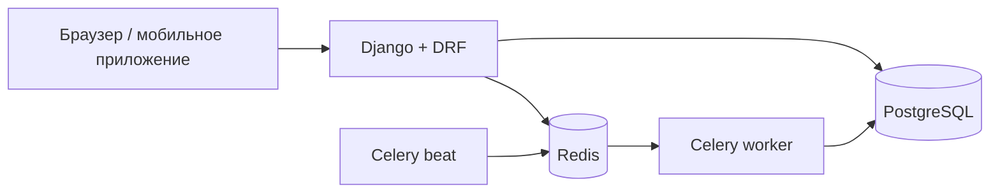

# Restaurant System

Система управления рестораном: меню, бронирование столиков, онлайн-заказы,
экран кухни в реальном времени и аналитика для владельца.

**Стек:** Python 3.12 · Django 5.2 · Django REST Framework · PostgreSQL 16 ·
Celery + Redis · Django Channels · Docker · pytest · GitHub Actions

## Статус разработки

| Этап | Что входит | Статус |
|---|---|---|
| 1. Каркас | Docker, настройки, пользователи с ролями, JWT, CI | ✅ |
| 2. Меню и столы | Категории, блюда, стоп-лист, QR-коды столов, сайт меню | ✅ |
| 3. Бронирование | Автоподбор стола, защита от двойной брони, форма на сайте | ✅ |
| 4. Заказы и оплата | Корзина, статусы заказа, Stripe test mode | ⏳ |
| 5. Real-time | Экран кухни и статус заказа через WebSocket | ⏳ |
| 6. Фоновые задачи и аналитика | Напоминания, автоотмена, Telegram, дашборд | ⏳ |
| 7. Продакшен | Деплой, финальная документация | ⏳ |

## Быстрый старт

Нужен [Docker Desktop](https://www.docker.com/products/docker-desktop/).

```bash
cp .env.example .env
docker compose up --build
```

Создать администратора и заполнить базу демо-данными (меню узбекской кухни,
10 столов, сотрудники `demo_manager`, `demo_cook`, `demo_waiter`, `demo_courier`
с паролем из `SEED_STAFF_PASSWORD` или `DEFAULT_STAFF_PASSWORD` в
[seed_data.py](apps/menu/management/commands/seed_data.py)):

```bash
docker compose exec web python manage.py createsuperuser
docker compose exec web python manage.py seed_data --with-staff
```

| Адрес | Что там |
|---|---|
| http://localhost:8000/ | Сайт ресторана |
| http://localhost:8000/menu/ | Меню с фильтром по тегам |
| http://localhost:8000/reservations/new/ | Бронирование столика |
| http://localhost:8000/api/docs/ | Swagger, документация API |
| http://localhost:8000/admin/ | Django Admin |
| http://localhost:8000/health/ | Проверка живости сервиса |

## Тесты и линтер

```bash
docker compose exec web pytest --cov
docker compose exec web ruff check .
```

## API

Все эндпоинты версионированы: `/api/v1/...`

| Метод | URL | Доступ | Описание |
|---|---|---|---|
| POST | `/api/v1/auth/register/` | все | Регистрация гостя |
| POST | `/api/v1/auth/token/` | все | Получить access и refresh токены |
| POST | `/api/v1/auth/token/refresh/` | все | Обновить access-токен |
| GET, PATCH | `/api/v1/auth/me/` | авторизованные | Профиль текущего пользователя |
| GET | `/api/v1/menu/dishes/` | все | Блюда: `?category=`, `?tag=`, `?price_min=`, `?price_max=`, `?search=`, `?ordering=price` |
| POST, PATCH, DELETE | `/api/v1/menu/dishes/{slug}/` | менеджер | Управление блюдами |
| PATCH | `/api/v1/menu/dishes/{slug}/availability/` | повар, менеджер | Стоп-лист |
| GET / POST, PATCH, DELETE | `/api/v1/menu/categories/`, `/api/v1/menu/tags/` | все / менеджер | Категории и теги |
| GET | `/api/v1/tables/` | менеджер, официант | Список столов |
| POST, PATCH, DELETE | `/api/v1/tables/{id}/` | менеджер | Управление столами |
| GET | `/api/v1/tables/{id}/qr/` | менеджер | PNG с QR-кодом для печати |
| POST | `/api/v1/tables/{id}/regenerate-qr/` | менеджер | Перевыпустить QR (старый перестанет работать) |
| GET | `/api/v1/tables/by-qr/{token}/` | все | Стол по токену из QR |
| GET | `/api/v1/reservations/availability/?date=&guests=` | все | Свободное время на день |
| POST | `/api/v1/reservations/` | все | Забронировать (стол подбирается автоматически) |
| GET | `/api/v1/reservations/my/` | авторизованные | Мои брони |
| GET | `/api/v1/reservations/` | менеджер, официант | Все брони: `?date=`, `?status=`, `?table=` |
| GET | `/api/v1/reservations/{id}/` | владелец, персонал | Бронь |
| POST | `/api/v1/reservations/{id}/cancel/` | владелец, персонал | Отменить бронь |
| POST | `/api/v1/reservations/{id}/status/` | менеджер, официант | Гость пришёл / не пришёл |
| GET, POST | `/api/v1/reservations/by-token/{token}/` (`cancel/`) | все | Бронь по личной ссылке гостя |

## Архитектура



```
config/            настройки (base / dev / test / prod), urls, celery
apps/
  users/           пользователь, роли, JWT
  menu/            категории, теги, блюда, страницы сайта, seed_data
  tables/          столы и QR-коды
  reservations/    бронирование: правила, подбор стола, форма на сайте
  core/            общие исключения
    api/           сериализаторы, views, urls
    services.py    бизнес-логика (запись)
    selectors.py   сложные запросы на чтение
    tests/
templates/         HTML-шаблоны сайта
static/css/        стили
```

## Технические решения

- **Кастомная модель User с первой миграции.** Если начать со стандартной
  модели, позже заменить её очень сложно.
- **Роль — одно поле, а не Django Groups.** У сотрудника одна должность,
  а проверка `user.role` не требует запросов к БД. Права описываются
  через `role_required(User.Role.COOK, User.Role.MANAGER)`.
- **Регистрация всегда создаёт гостя.** Поля `role` во входном
  сериализаторе нет, поэтому зарегистрироваться как менеджер нельзя.
  Сотрудников создаёт администратор.
- **Email уникален без учёта регистра.** `Ivan@Mail.ru` и `ivan@mail.ru`
  считаются одним адресом.
- **Закрытый по умолчанию API.** Глобально стоит `IsAuthenticated`,
  публичные эндпоинты явно помечены `AllowAny`.
- **Лимит запросов на вход и регистрацию** (10 в минуту) защищает
  от перебора паролей.
- **Бизнес-логика в `services.py`.** Views только принимают запрос
  и отдают ответ, поэтому логику легко тестировать и переиспользовать.
- **Меню без N+1.** Страница меню делает ровно 4 запроса к БД при любом
  количестве блюд (`Prefetch` с `to_attr`), список блюд в API — 3.
  Это закреплено тестами через `django_assert_num_queries`.
- **Цены в `DecimalField` + `CHECK price > 0` в БД.** Валидатор даёт
  понятную ошибку 400, а constraint защищает даже от кода, который
  пишет в БД в обход сериализаторов.
- **`on_delete=PROTECT` для категорий.** Удалить категорию с блюдами нельзя:
  API отвечает 409 Conflict, а не 500.
- **Стоп-лист не срабатывает от пустого запроса.** Стандартный
  `BooleanField` в form-data считает отсутствующее поле значением `False`,
  и пустой PATCH убрал бы блюдо из меню. Поэтому используется
  `RequiredBooleanField`.
- **QR-код содержит UUID, а не номер стола.** Ссылку `/t/5/` легко
  перебрать и заказывать за чужой стол. Если ссылка утекла, токен
  перевыпускается одной кнопкой.
- **Двойная защита от двойного бронирования.**
  1. Сервис открывает транзакцию и блокирует подходящие столы через
     `select_for_update`. Параллельный запрос ждёт и после разблокировки
     уже видит первую бронь.
  2. В PostgreSQL стоит `EXCLUDE USING gist (table_id WITH =,
     tstzrange(start_at, end_at, '[)') WITH &&) WHERE status = 'confirmed'`
     ([миграция](apps/reservations/migrations/0002_no_overlapping_reservations.py)).
     Даже код в обход сервиса не создаст пересекающиеся брони.
  Оба механизма проверяются тестами на PostgreSQL, включая тест
  с двумя потоками, которые одновременно бронируют последний стол.
- **Интервалы полуоткрытые `[start, end)`.** Бронь 17:00–19:00 и бронь
  с 19:00 на один стол не конфликтуют.
- **Подбирается самый маленький подходящий стол.** VIP-зал на 10 мест
  не уйдёт паре гостей, пока есть стол на двоих.
- **Правила бронирования — чистые функции** ([rules.py](apps/reservations/rules.py)).
  Часы работы, шаг 30 минут, минимум за 30 минут, максимум на 30 дней.
  `now` передаётся параметром, поэтому тесты не зависят от текущего времени.
- **Свободные слоты считаются за 2 запроса на весь день**, а не по
  запросу на каждый из 23 слотов.
- **Гость без аккаунта управляет бронью по секретной ссылке** с UUID-токеном.
  Последовательный id для этого не годится: его легко перебрать.
- **409 Conflict, если мест нет.** Это отличается от 400 (неверные данные):
  клиенту стоит предложить другое время, а не исправлять форму.
- **Продакшен-настройки без значений по умолчанию для секретов.**
  Если `DJANGO_SECRET_KEY` не задан, приложение не запустится.
  CI проверяет настройки через `manage.py check --deploy`.
