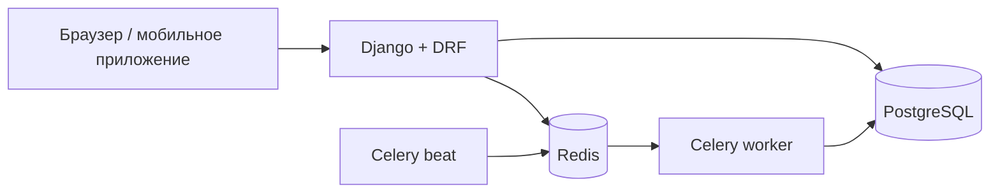

# Restaurant System

Система управления рестораном: меню, бронирование столиков, онлайн-заказы,
экран кухни в реальном времени и аналитика для владельца.

**Стек:** Python 3.12 · Django 5.2 · Django REST Framework · PostgreSQL 16 ·
Celery + Redis · Django Channels · Docker · pytest · GitHub Actions

## Статус разработки

| Этап | Что входит | Статус |
|---|---|---|
| 1. Каркас | Docker, настройки, пользователи с ролями, JWT, CI | ✅ |
| 2. Меню и столы | Категории, блюда, стоп-лист, QR-коды столов | ⏳ |
| 3. Бронирование | Автоподбор стола, защита от двойной брони | ⏳ |
| 4. Заказы и оплата | Корзина, статусы заказа, Stripe test mode | ⏳ |
| 5. Real-time | Экран кухни и статус заказа через WebSocket | ⏳ |
| 6. Фоновые задачи и аналитика | Напоминания, автоотмена, Telegram, дашборд | ⏳ |
| 7. Продакшен | Деплой, финальная документация | ⏳ |

## Быстрый старт

Нужен [Docker Desktop](https://www.docker.com/products/docker-desktop/).

```bash
cp .env.example .env
docker compose up --build
```

Создать администратора:

```bash
docker compose exec web python manage.py createsuperuser
```

| Адрес | Что там |
|---|---|
| http://localhost:8000/api/docs/ | Swagger, документация API |
| http://localhost:8000/admin/ | Django Admin |
| http://localhost:8000/health/ | Проверка живости сервиса |

## Тесты и линтер

```bash
docker compose exec web pytest --cov
docker compose exec web ruff check .
```

## API

Все эндпоинты версионированы: `/api/v1/...`

| Метод | URL | Доступ | Описание |
|---|---|---|---|
| POST | `/api/v1/auth/register/` | все | Регистрация гостя |
| POST | `/api/v1/auth/token/` | все | Получить access и refresh токены |
| POST | `/api/v1/auth/token/refresh/` | все | Обновить access-токен |
| GET, PATCH | `/api/v1/auth/me/` | авторизованные | Профиль текущего пользователя |

## Архитектура



```
config/            настройки (base / dev / test / prod), urls, celery
apps/
  users/           пользователь, роли, JWT
    api/           сериализаторы, views, urls
    services.py    бизнес-логика (запись)
    permissions.py права доступа по ролям
    tests/
```

## Технические решения

- **Кастомная модель User с первой миграции.** Если начать со стандартной
  модели, позже заменить её очень сложно.
- **Роль — одно поле, а не Django Groups.** У сотрудника одна должность,
  а проверка `user.role` не требует запросов к БД. Права описываются
  через `role_required(User.Role.COOK, User.Role.MANAGER)`.
- **Регистрация всегда создаёт гостя.** Поля `role` во входном
  сериализаторе нет, поэтому зарегистрироваться как менеджер нельзя.
  Сотрудников создаёт администратор.
- **Email уникален без учёта регистра.** `Ivan@Mail.ru` и `ivan@mail.ru`
  считаются одним адресом.
- **Закрытый по умолчанию API.** Глобально стоит `IsAuthenticated`,
  публичные эндпоинты явно помечены `AllowAny`.
- **Лимит запросов на вход и регистрацию** (10 в минуту) защищает
  от перебора паролей.
- **Бизнес-логика в `services.py`.** Views только принимают запрос
  и отдают ответ, поэтому логику легко тестировать и переиспользовать.
- **Продакшен-настройки без значений по умолчанию для секретов.**
  Если `DJANGO_SECRET_KEY` не задан, приложение не запустится.
  CI проверяет настройки через `manage.py check --deploy`.
