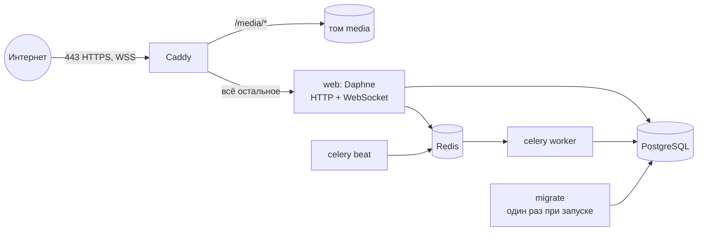

# Деплой на VPS

Схема: один сервер с Docker. Внутри `docker-compose.prod.yml` работают:



| Сервис | Зачем |
|---|---|
| `caddy` | HTTPS с автоматическим сертификатом Let's Encrypt, проксирует WebSocket, отдаёт фото блюд |
| `web` | Django на Daphne (ASGI): сайт, API, WebSocket. Статику отдаёт WhiteNoise |
| `migrate` | Применяет миграции и завершается. `web` и воркеры ждут его успешного выхода |
| `celery`, `celery-beat` | Уведомления, автоотмена неоплаченных заказов, напоминания о брони |
| `db`, `redis` | PostgreSQL 16 и Redis 7. Порты наружу не открыты |

## 1. Сервер

Подойдёт любой VPS с 1–2 ГБ памяти и Ubuntu 22.04/24.04.

```bash
curl -fsSL https://get.docker.com | sh
sudo usermod -aG docker $USER   # перелогиниться после этого
```

Открой порты 80 и 443. Порт 80 нужен Caddy, чтобы получить сертификат.

## 2. Домен

Создай A-запись домена (например `bahor.example.uz`) на IP сервера.
Дождись, пока она обновится: `dig +short bahor.example.uz` должен показать IP сервера.

## 3. Код и настройки

```bash
git clone https://github.com/<твой-аккаунт>/restaurant-system.git
cd restaurant-system
cp .env.prod.example .env.prod
nano .env.prod
```

Обязательно заполни:

- `DOMAIN`, `DJANGO_ALLOWED_HOSTS`, `DJANGO_CSRF_TRUSTED_ORIGINS`, `SITE_URL` — твой домен;
- `DJANGO_SECRET_KEY` — сгенерируй: `python3 -c "import secrets; print(secrets.token_urlsafe(50))"`;
- `POSTGRES_PASSWORD` и тот же пароль в `DATABASE_URL`;
- `DJANGO_ADMIN_URL` — свой адрес админки вместо `admin/`.

Для оплаты понадобятся `STRIPE_SECRET_KEY` и `STRIPE_WEBHOOK_SECRET` (шаг 6).
`PAYMENT_PROVIDER=fake` в продакшене запрещён: приложение не запустится.

## 4. Запуск

```bash
docker compose -f docker-compose.prod.yml up -d --build
docker compose -f docker-compose.prod.yml ps
```

Все сервисы должны быть `running`, у `web` статус `healthy`, а `migrate` завершается с кодом 0.
Через минуту сайт откроется по `https://<домен>`, сертификат Caddy получит сам.

Администратор и (по желанию) демо-данные:

```bash
docker compose -f docker-compose.prod.yml exec web python manage.py createsuperuser
docker compose -f docker-compose.prod.yml exec web python manage.py seed_data --with-staff
```

Пароль демо-сотрудников задаётся переменной `SEED_STAFF_PASSWORD`. На настоящем
сайте лучше создать сотрудников в админке с собственными паролями.

## 5. Проверка

```bash
curl -s https://<домен>/health/          # {"status": "ok"}
docker compose -f docker-compose.prod.yml logs -f web
```

Открой `https://<домен>/staff/kitchen/` в одной вкладке и оформи заказ в другой:
карточка должна появиться без перезагрузки. Значит, WebSocket проходит через Caddy.

## 6. Stripe

1. В [Stripe Dashboard](https://dashboard.stripe.com/test/webhooks) добавь endpoint
   `https://<домен>/api/v1/payments/webhook/stripe/` с событиями
   `checkout.session.completed` и `checkout.session.expired`.
2. Секрет подписи (`whsec_...`) запиши в `STRIPE_WEBHOOK_SECRET`, ключ — в `STRIPE_SECRET_KEY`.
3. Перезапусти приложение: `docker compose -f docker-compose.prod.yml up -d`.

## Обновление

```bash
git pull
docker compose -f docker-compose.prod.yml up -d --build
```

Миграции применятся сами (сервис `migrate`) до старта нового `web`.

## Резервные копии

Ежедневный дамп базы через cron (`crontab -e`):

```bash
0 3 * * * cd ~/restaurant-system && docker compose -f docker-compose.prod.yml exec -T db pg_dump -U restaurant restaurant | gzip > ~/backups/db-$(date +\%F).sql.gz
```

Восстановление:

```bash
gunzip -c ~/backups/db-2026-10-22.sql.gz | docker compose -f docker-compose.prod.yml exec -T db psql -U restaurant restaurant
```

Фото блюд лежат в томе `media`. Их тоже стоит копировать:
`docker run --rm -v restaurant-system_media:/media -v ~/backups:/backup alpine tar czf /backup/media.tar.gz -C /media .`

## Что настроено для безопасности

- HTTPS везде: HSTS, `Secure`-cookie, редирект с HTTP, заголовок `X-Forwarded-Proto` от Caddy.
- Реальный IP клиента: Caddy не доверяет входящему `X-Forwarded-For`, Daphne запущен
  с `--proxy-headers`, а DRF настроен на `NUM_PROXIES=1`. Лимиты на вход и регистрацию
  нельзя обойти, подделав заголовок.
- Общий кэш в Redis: лимиты запросов и блокировка перебора паролей общие для всех процессов.
- Вход персонала блокируется после 10 неудачных попыток с одного IP на 15 минут.
- Админка по нестандартному адресу, БД и Redis без открытых портов, контейнеры не от root.
- Секреты только в `.env.prod`, который не попадает ни в git, ни в Docker-образ.
